# Estudio y Diseño de Trabajo — Diagramas de proceso y de operación (Unidad II, consolidado)

**Tema:** 2.1 Diagramas de proceso (operación, flujo, recorrido) y 2.2 Diagramas de operación (bimanual, hombre-máquina, actividades múltiples)  
**Cubre:** Sesión 3 (Semana 3) y Sesión 4 (Semana 4), en un solo documento  
**Propósito:** Que el estudiante identifique la simbología, el formato y el uso de los seis diagramas de la Unidad II, sepa leer un diagrama ya elaborado y construya uno propio, como base directa de la **Actividad 2: Elaboración de diagrama y cuadro comparativo** (10 puntos, vence el 12 de octubre de 2026).

> **Imágenes.** Las imágenes de apoyo están en la carpeta `imagenes/` de este repositorio. La sección 12 lista los nombres de archivo.

---

## Índice

0. Definiciones conceptuales clave
1. Simbología
2. Diagrama de proceso de operación (DOP)
3. Diagrama de proceso de flujo
4. Diagrama de proceso de recorrido (sobre layout)
5. Diagrama bimanual (mano izquierda – mano derecha)
6. Diagrama hombre-máquina
7. Diagrama de actividades múltiples
8. Convenciones, criterios de análisis y preguntas guía (Peralta)
9. Cuadro comparativo de los seis diagramas
10. Actividad en aula
11. Cierre y vínculo con la Actividad 2
12. Guía de imágenes para la carpeta de GitHub
13. Referencias (formato APA)

---

## 0. Definiciones conceptuales clave

**Estudio de métodos.** Registro y examen crítico y sistemático de los modos existentes y proyectados de llevar a cabo un trabajo, con el fin de idear y aplicar métodos más sencillos y eficaces, y de reducir los costos (Kanawaty, 1996).

**Diagrama de proceso.** Representación gráfica de la secuencia de las operaciones, transportes, inspecciones, demoras y almacenamientos que ocurren durante un proceso, con la información necesaria para el análisis: distancia recorrida, cantidad considerada y tiempo requerido (Niebel & Freivalds, 2009).

**Diagrama de proceso de operación (DOP).** Presenta la secuencia cronológica de las operaciones e inspecciones de un proceso completo, con los puntos de entrada de materiales y componentes. No detalla transportes, demoras ni almacenamientos (Kanawaty, 1996).

**Diagrama de proceso de flujo.** Versión detallada que incorpora los cinco eventos: operación, transporte, inspección, demora y almacenamiento, con distancia y tiempo de cada uno (Niebel & Freivalds, 2009).

**Diagrama de recorrido.** Plano a escala (layout) del área sobre el que se traza la ruta del material o del operario, ubicando cada evento en el punto físico donde ocurre (Niebel & Freivalds, 2009).

**Diagrama bimanual.** Registra, en paralelo, los movimientos de la mano izquierda y de la derecha de un operario en una operación manual de ciclo corto y alta repetición, para detectar movimientos innecesarios o desbalanceados (Niebel & Freivalds, 2009).

**Diagrama hombre-máquina.** Representa, sobre una misma escala de tiempo, la actividad de un operario y la de la máquina que atiende, para identificar el tiempo de trabajo simultáneo y el tiempo ocioso de cada uno (Niebel & Freivalds, 2009).

**Diagrama de actividades múltiples.** Extensión del diagrama hombre-máquina a un operario que atiende varias máquinas, o a varios operarios y máquinas que trabajan juntos, para determinar cuántas máquinas puede atender un operario sin tiempos muertos excesivos (Niebel & Freivalds, 2009).

**Tiempo ocioso.** Intervalo del ciclo en que el operario o la máquina no realizan trabajo productivo. Es el principal punto de mejora que estos diagramas hacen visible.

---

## 1. Simbología

### 1.1 Simbología ASME para diagramas de proceso

| Símbolo | Evento | Significado |
|---|---|---|
| ○ Círculo | Operación | Se modifica, ensambla o prepara el objeto. |
| □ Cuadrado | Inspección | Se verifica calidad o cantidad sin modificar el objeto. |
| ⇨ Flecha | Transporte | El objeto o la persona se desplaza de un lugar a otro. |
| D (semicírculo) | Demora o espera | La siguiente acción no puede ejecutarse de inmediato. |
| ▽ Triángulo invertido | Almacenamiento | El objeto se guarda y se protege de un traslado no autorizado. |
| ○ dentro de □ | Operación combinada | Operación e inspección simultáneas en el mismo punto. |

Las descripciones del libro de Peralta para estos símbolos, con la diferencia entre espera necesaria e innecesaria, están en la sección 8.1.

### 1.2 Simbología del diagrama bimanual

Los formatos bimanuales de la sección 5 usan los mismos símbolos ASME, con este significado para cada mano:

| Símbolo | Significado en el diagrama bimanual |
|---|---|
| ○ | **Operación**: la mano sujeta, posiciona, ensambla o usa una herramienta sobre la pieza. |
| ⇨ | **Transporte**: la mano se desplaza, vacía o con la pieza o herramienta. |
| D | **Espera**: la mano está inactiva mientras la otra trabaja. |
| □ | **Inspección**: la mano verifica la pieza. |
| ▽ | **Sostenimiento**: la mano sostiene la pieza o la herramienta mientras la otra opera. |

Los formatos de la sección 5 incluyen una columna **THERBLIGS**. Los *therbligs* son los movimientos básicos que descomponen una operación manual (tomar, mover, posicionar, sostener, soltar, etc.), propuestos por Frank y Lillian Gilbreth. Permiten describir cada movimiento con más detalle que los cinco símbolos.

### 1.3 Simbología del diagrama hombre-máquina

Ver la imagen de la sección 6.2 y su tabla.

---

## 2. Diagrama de proceso de operación (DOP)

### 2.1 Qué es y para qué sirve

El DOP es el primer diagrama que se elabora al analizar un proceso, porque da una **visión panorámica** de él: qué se hace, en qué orden y con qué materiales (Kanawaty, 1996). Sirve para presentar el proceso a la dirección, comparar métodos alternativos de fabricar el mismo producto y decidir en qué operaciones conviene profundizar con otro diagrama.

### 2.2 Cómo se lee

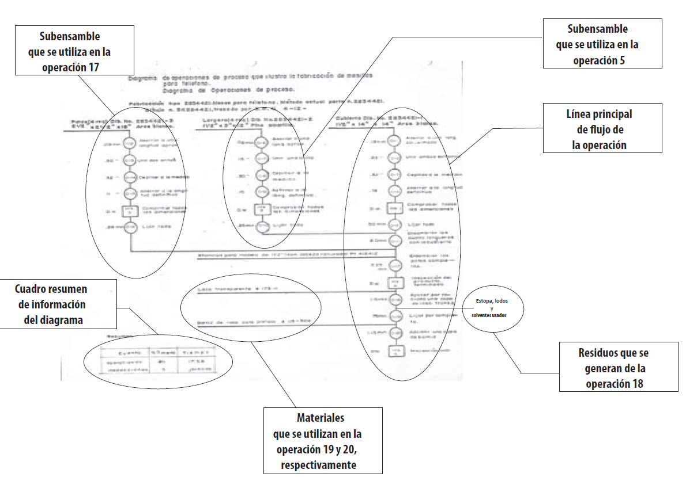

Elementos que se leen en este tipo de diagrama:

- **Línea principal de flujo (vertical):** la secuencia de operaciones e inspecciones del componente principal, de arriba hacia abajo.
- **Líneas de subensamble (horizontales que desembocan en la línea principal):** cada subensamble o componente tiene su propia columna, que termina cuando se une a la línea principal.
- **Lado izquierdo de una línea de rama:** entradas de **materiales o suministros**.
- **Lado derecho de una línea de rama:** **residuos, mermas o desperdicios** que genera la operación.
- **Numeración consecutiva** de operaciones e inspecciones, con el tiempo estimado al lado de cada una.
- **Cuadro resumen:** total de operaciones, inspecciones y tiempo.

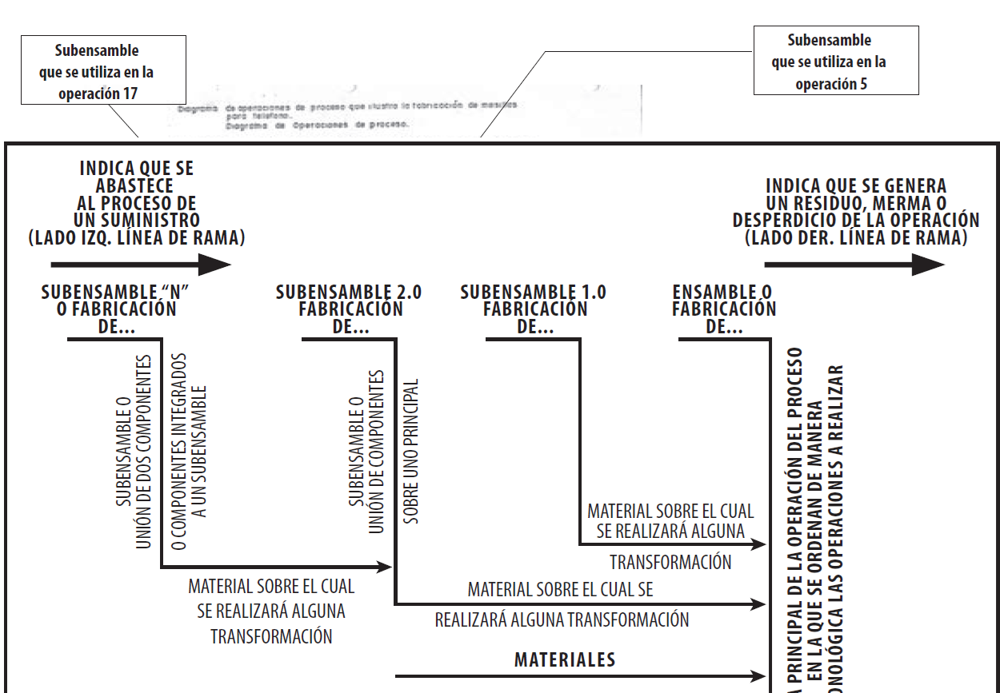

### 2.3 Ejemplo con formato completo

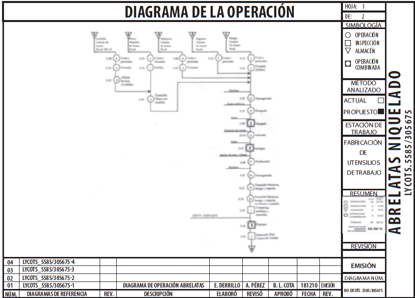

El formato completo incluye, además del dibujo:

- Simbología utilizada (operación, inspección, almacén, demora, transporte, operación combinada).
- **Método analizado:** actual o propuesto.
- Nombre del producto y código.
- **Resumen** de operaciones, inspecciones, almacenes y tiempo total.
- Control de versión: hoja, diagrama núm., revisión, quién elaboró, revisó y aprobó, y fecha.

### 2.4 Pasos para construir un DOP

1. Elige el proceso y define su **inicio** (materia prima) y su **fin** (producto empacado o entregado).
2. Lista **todas las operaciones e inspecciones** en orden cronológico. No incluyas transportes, demoras ni almacenamientos.
3. Identifica el **componente principal** y dibuja su línea vertical.
4. Dibuja cada **subensamble** en su columna y únelo a la línea principal en el punto donde se ensambla.
5. Marca los **materiales** que entran (lado izquierdo) y los **residuos** que salen (lado derecho).
6. Numera las operaciones y las inspecciones **de forma consecutiva**, y anota el tiempo de cada una si lo tienes.
7. Llena el **cuadro resumen** y los datos del encabezado.

### 2.5 Ejemplo resuelto: carpeta de tres argollas

| # | Símbolo | Descripción |
|---|---|---|
| 1 | ○ Operación | Cortar la lámina de cartón al tamaño de la tapa. |
| 2 | ○ Operación | Cortar el forro plástico al tamaño de la tapa. |
| 3 | ○ Operación | Laminar (unir) el cartón con el forro plástico. |
| 4 | □ Inspección | Verificar que no haya burbujas ni dobleces en el laminado. |
| 5 | ○ Operación | Perforar los orificios del mecanismo de argollas. |
| 6 | ○ Operación | Fijar el mecanismo metálico de tres argollas a la tapa. |
| 7 | □ Inspección | Verificar que las argollas abran y cierren correctamente. |
| 8 | ○ Operación | Doblar la tapa para formar el lomo y las dos caras. |
| 9 | □ Inspección | Inspección final de apariencia y funcionamiento antes del empaque. |

Resumen: 6 operaciones y 3 inspecciones. Este diagrama no dice nada de tiempos, distancias ni esperas. Para eso se necesita el diagrama de flujo (sección 3) o el de recorrido (sección 4).

---

## 3. Diagrama de proceso de flujo

### 3.1 Qué es y qué agrega al DOP

Incluye los cinco eventos (operación, transporte, inspección, demora y almacenamiento) y registra, para cada uno, **cantidad, distancia y tiempo**. Su valor es que hace visibles los **desperdicios**: transportes largos o repetidos, demoras entre operaciones y almacenamientos innecesarios (Kanawaty, 1996).

| Aspecto | DOP | Diagrama de flujo |
|---|---|---|
| Eventos | Operación e inspección | Los 5 eventos |
| Detalle | General | Detallado |
| Datos | Tiempo de operación | Distancia, tiempo y cantidad por evento |
| Uso típico | Visión general y comparar métodos | Detectar desperdicios de tiempo y movimiento |

### 3.2 Formato

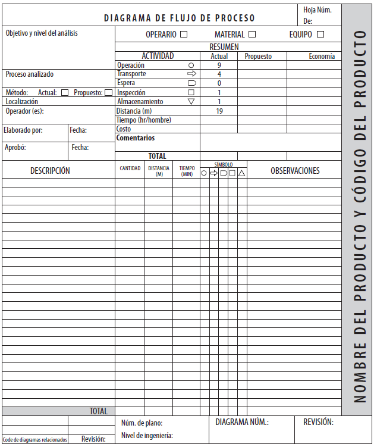

Cómo se llena:

- **Objetivo y nivel de análisis:** marca si el diagrama sigue al **operario**, al **material** o al **equipo**. Define a cuál sigues antes de empezar y no los mezcles.
- **Método:** actual o propuesto.
- **Resumen:** cuenta los eventos de cada tipo, la distancia total (m) y el tiempo total. Cuando haces la propuesta, llena la columna *Propuesto* y calcula la *Economía* (actual − propuesto).
- **Cuerpo del diagrama:** una línea por evento, con su descripción, cantidad, distancia (m), tiempo (min) y el símbolo marcado (unido con una línea vertical al siguiente evento).
- **Observaciones:** el motivo de una demora, el medio de transporte, el problema detectado.

### 3.3 Ejemplo: carpeta de tres argollas (datos ilustrativos)

| # | Descripción | Dist. (m) | Tiempo (min) | ○ | ⇨ | D | □ | ▽ |
|---|---|---|---|---|---|---|---|---|
| 1 | Almacén de materia prima (cartón y forro) | – | – | | | | | ▽ |
| 2 | Transportar lámina al área de corte | 12 | 0.8 | | ⇨ | | | |
| 3 | Cortar cartón y forro | – | 1.5 | ○ | | | | |
| 4 | Esperar a que se junte el lote | – | 10.0 | | | D | | |
| 5 | Laminar cartón con forro | – | 1.2 | ○ | | | | |
| 6 | Inspeccionar el laminado | – | 0.5 | | | | □ | |
| 7 | Transportar a perforado | 8 | 0.6 | | ⇨ | | | |
| 8 | Perforar y fijar el mecanismo | – | 2.0 | ○ | | | | |
| 9 | Inspeccionar argollas | – | 0.4 | | | | □ | |
| 10 | Transportar a empaque | 15 | 1.0 | | ⇨ | | | |
| 11 | Empacar y almacenar producto terminado | – | 1.5 | ○ | | | | ▽ |

Resumen ilustrativo: 4 operaciones, 3 transportes (35 m), 1 demora (10 min), 2 inspecciones y 2 almacenamientos. **Hallazgo:** la demora de 10 min es el mayor desperdicio y los tres transportes suman 35 m. Una propuesta sería balancear los lotes y acercar las estaciones.

---

## 4. Diagrama de proceso de recorrido (sobre layout)

### 4.1 Qué es y cuándo usarlo

Traslada el diagrama de flujo a un **plano a escala** de la planta o estación. Muestra **dónde** ocurre cada evento y **qué trayectoria** sigue el material o el operario. Revela recorridos largos, cruces de rutas y retrocesos que una lista secuencial no deja ver. Es la herramienta principal para proponer una redistribución (Niebel & Freivalds, 2009).

### 4.2 Ejemplo

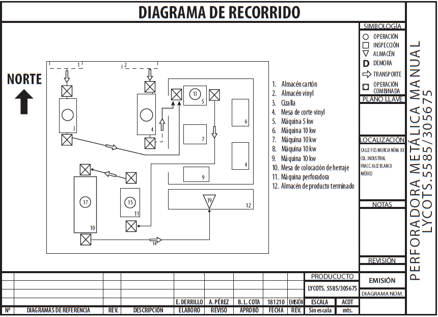

Elementos que se ven en este diagrama:

- **Layout a escala** con las áreas y los equipos numerados, y una **lista de referencias** (1. Almacén cartón, 2. Almacén vinil, 3. Cizalla, etc.).
- **Ruta** del material trazada con flechas.
- **Símbolos de proceso** (operación, inspección, almacén, demora, transporte, operación combinada) colocados en el punto físico donde ocurre cada evento.
- **Flecha del norte**, para orientar el plano.
- **Cuadro de datos:** localización, escala, quién elaboró, revisó y aprobó, y fecha.

### 4.3 Pasos para construirlo

1. Obtén o dibuja el **layout** del área, a escala. Anota las medidas principales.
2. **Numera** cada máquina, mesa y almacén, y escribe la lista de referencias.
3. Ten a la mano tu **diagrama de flujo** del mismo proceso, para no cambiar los pasos.
4. Traza con una línea la **ruta del material** de punto a punto, con flechas de dirección.
5. Coloca el **símbolo** de cada evento en el lugar donde ocurre, con el mismo número que en el diagrama de flujo.
6. Mide las **distancias** de los transportes con la escala y compáralas con las de tu diagrama de flujo.
7. Busca **cruces, retrocesos y tramos largos**, y anótalos como hallazgos.

---

## 5. Diagrama bimanual (mano izquierda – mano derecha)

### 5.1 Qué es y cuándo usarlo

Se usa para operaciones **manuales de ciclo corto y alta repetición** (ensamble, empaque, costura). Se diagrama **una sola operación**, no el proceso completo. Su objetivo es que ambas manos trabajen de forma balanceada, sin esperas ni sostenimientos innecesarios (Niebel & Freivalds, 2009).

### 5.2 Ejemplo anotado

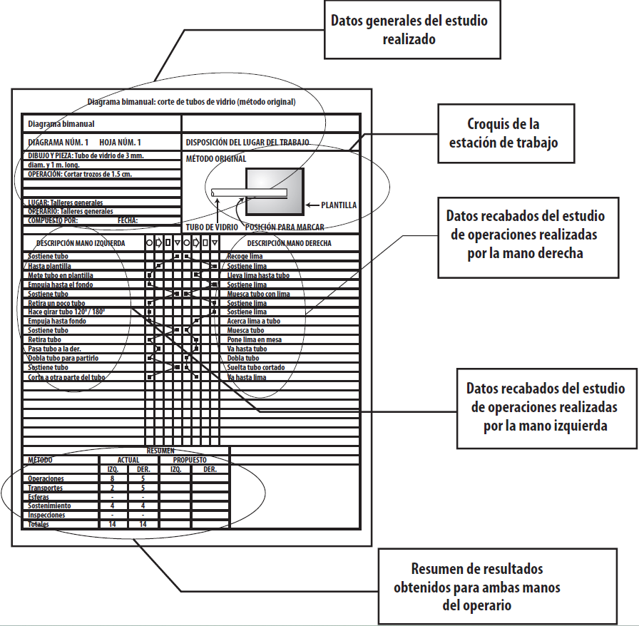

Partes del formato:

- **Datos generales:** nombre de la operación, dibujo y pieza, lugar, operario, quién lo compone y fecha.
- **Croquis de la estación de trabajo** (disposición del lugar de trabajo), con la posición de la pieza, la herramienta y la plantilla.
- **Dos columnas de descripción:** mano izquierda y mano derecha, con el mismo nivel de detalle y alineadas por renglón.
- **Columnas de símbolos** para cada mano.
- **Resumen** por mano, con el método **actual** y el **propuesto**: operaciones, transportes, esperas, sostenimientos, inspecciones y total. En el ejemplo, el método original tiene 14 eventos por mano. La mano izquierda registra 8 operaciones, 2 transportes y 4 sostenimientos; la derecha, 5 operaciones, 5 transportes y 4 sostenimientos.

### 5.3 Formatos para elaborar el tuyo

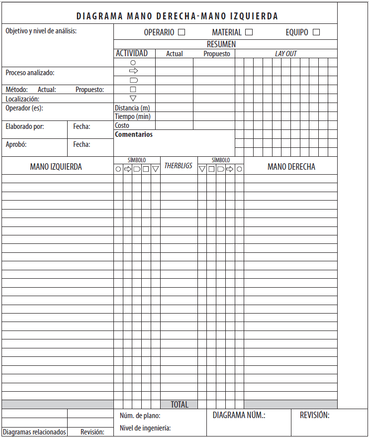

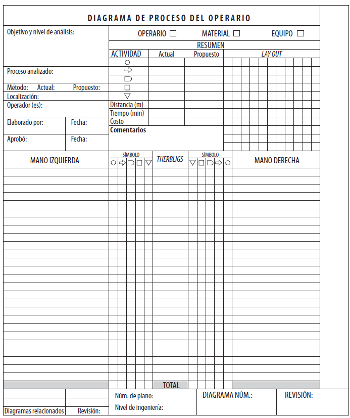

### 5.4 Reglas para construirlo

1. Diagrama **una sola operación** de ciclo corto, desde que las manos toman la pieza hasta que la sueltan.
2. Escribe **una fila por movimiento** y alinea lo que ocurre al mismo tiempo en ambas manos.
3. Describe ambas manos con **el mismo nivel de detalle**.
4. Marca el símbolo correcto de cada movimiento (sección 1.2).
5. Cuenta los símbolos y llena el **resumen** del método actual.
6. Busca **sostenimientos y esperas** de una mano mientras la otra trabaja, y **manos que no empiezan o terminan juntas**.
7. Elabora el **método propuesto** y llena su columna del resumen.

### 5.5 Ejemplo resuelto: engomado y pegado de suela (Zapatería Industrial XYZ)

| Mano izquierda | Símb. | Símb. | Mano derecha |
|---|---|---|---|
| Sostiene el corte del zapato | ▽ | ⇨ | Toma la brocha con pegamento |
| (sigue sosteniendo) | ▽ | ○ | Aplica pegamento al borde de la suela |
| (sigue sosteniendo) | ▽ | ⇨ | Deja la brocha y toma la suela |
| Ayuda a posicionar la suela sobre el corte | ○ | ○ | Presiona la suela contra el corte |
| Sostiene el zapato en la prensa | ▽ | ○ | Acciona la prensa de pegado |

Resumen del método actual:

| | Izq. | Der. |
|---|---|---|
| Operaciones | 1 | 3 |
| Transportes | 0 | 2 |
| Esperas | 0 | 0 |
| Sostenimientos | 4 | 0 |
| Inspecciones | 0 | 0 |
| **Total** | **5** | **5** |

**Hallazgo:** la mano izquierda pasa 4 de 5 movimientos en sostenimiento, mientras la derecha concentra la actividad. **Propuesta:** una base de sujeción fija en la prensa liberaría la mano izquierda para preparar el siguiente par, y el resumen propuesto mostraría 0 sostenimientos.

---

## 6. Diagrama hombre-máquina

### 6.1 Qué es

A diferencia del bimanual (mano izquierda contra mano derecha), compara el trabajo del **operario** contra el de la **máquina** sobre una **misma escala de tiempo**. Revela:

- El tiempo de **trabajo simultáneo** de operario y máquina.
- El **tiempo ocioso del operario**: la máquina trabaja sola (ciclo automático). Es la oportunidad de asignarle otra tarea o atender otra máquina (sección 7).
- El **tiempo ocioso de la máquina**: el operario carga, descarga o ajusta, y la máquina está detenida. Es la oportunidad de reducir ese tiempo con otro método o con dispositivos.

### 6.2 Simbología y formato

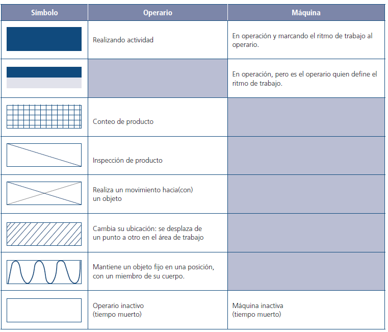

| Sombreado | Operario | Máquina |
|---|---|---|
| Relleno completo | Realizando actividad | En operación y marcando el ritmo de trabajo al operario |
| Mitad rellena | – | En operación, pero es el operario quien define el ritmo de trabajo |
| Cuadrícula | Conteo de producto | – |
| Diagonal | Inspección de producto | – |
| Cruz (X) | Realiza un movimiento hacia (con) un objeto | – |
| Rayado oblicuo | Cambia su ubicación: se desplaza de un punto a otro en el área de trabajo | – |
| Onda | Mantiene un objeto fijo en una posición con un miembro de su cuerpo | – |
| Vacío | Operario inactivo (tiempo muerto) | Máquina inactiva (tiempo muerto) |

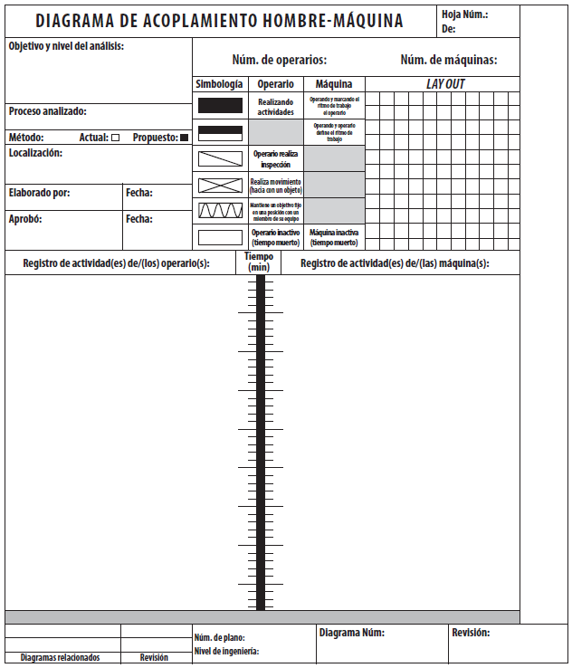

### 6.3 Ejemplo anotado

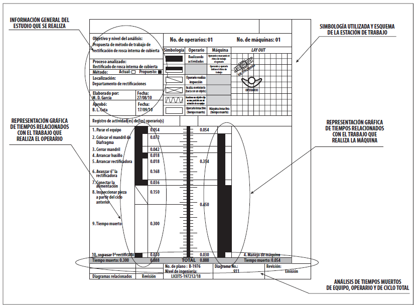

Cómo se lee:

- **Encabezado:** objetivo, proceso analizado, método (actual o propuesto), número de operarios y de máquinas, quién elaboró y aprobó.
- **Columna izquierda:** lista de actividades del operario en orden, con su duración.
- **Barra central:** la escala de tiempo.
- **Columna derecha:** la actividad de la máquina, a la misma escala.
- **Fila inferior (total):** tiempo del ciclo y **tiempo muerto** del operario y de la máquina.

### 6.4 Indicadores

- Tiempo del ciclo = duración de una repetición completa.
- % de utilización del operario = (tiempo trabajando el operario ÷ tiempo del ciclo) × 100.
- % de utilización de la máquina = (tiempo trabajando la máquina ÷ tiempo del ciclo) × 100.

### 6.5 Ejemplo resuelto: máquina de coser el corte (Zapatería Industrial XYZ)

| Tiempo (s) | Operario | Máquina |
|---|---|---|
| 0–5 | Carga el corte | (detenida) |
| 5–25 | Espera (ocioso) | Cose el corte (automático) |
| 25–28 | Descarga el corte terminado | (detenida) |

- Ciclo: **28 s**.
- Ocioso del operario: **20 s**. Ocioso de la máquina: **8 s**.
- Utilización del operario = 8 ÷ 28 ≈ **28.6 %**. Utilización de la máquina = 20 ÷ 28 ≈ **71.4 %**.

**Lectura:** el operario tiene 20 s ociosos por ciclo mientras la máquina cose sola. La sección 7 responde si puede atender más de una máquina en ese tiempo.

---

## 7. Diagrama de actividades múltiples

### 7.1 Qué es

Cuando el operario tiene mucho tiempo ocioso en el diagrama hombre-máquina, la pregunta es: **¿cuántas máquinas puede atender sin que ninguna espere por él?** El diagrama de actividades múltiples la responde con varias columnas en paralelo (operario(s) y máquinas).

### 7.2 Fórmula del número ideal de máquinas

Con los tiempos de un ciclo (Niebel & Freivalds, 2009):

> **n = (l + m) / (l + w)**

- **n** = número ideal de máquinas por operario.
- **l** = tiempo del operario por máquina (**carga, descarga, ajuste**), en cada ciclo.
- **m** = tiempo de la máquina trabajando **sola** (ciclo automático).
- **w** = tiempo de **traslado** del operario entre máquinas. Se considera 0 si las máquinas están juntas.

Si **n no es entero**, se comparan los dos enteros vecinos (n₁ = el menor, n₂ = el mayor) por su **costo por pieza** y se elige el menor:

| Caso | Ciclo (T) | Costo por pieza |
|---|---|---|
| n₁ máquinas (entero menor) | T = l + m (el operario espera al final) | (K₁ + n₁·K₂) · T ÷ n₁ |
| n₂ máquinas (entero mayor) | T = n₂ · (l + w) (las máquinas esperan al operario) | (K₁ + n₂·K₂) · T ÷ n₂ |

K₁ es el costo por hora del operario y K₂ el costo por hora de cada máquina.

### 7.3 Ejemplo con los datos de la máquina de coser

Con los datos de la sección 6.5: l = 5 + 3 = 8 s, m = 20 s, w = 0 (máquinas juntas):

n = (8 + 20) ÷ (8 + 0) = 28 ÷ 8 = **3.5**

Un operario puede atender hasta **3 máquinas sin que ninguna espere**. Con 3 máquinas, el ciclo sigue siendo de 28 s: el operario trabaja 24 s y descansa 4 s. Con 4 máquinas, el ciclo sube a 4 × 8 = 32 s y cada máquina espera 4 s al operario.

Comparación de costos (costos **ilustrativos**: operario $80/h y máquina $150/h):

| Opción | Ciclo (T) | Costo por pieza |
|---|---|---|
| 3 máquinas | 28 s | (80 + 3·150) × 28/3600 ÷ 3 ≈ **$1.37** |
| 4 máquinas | 32 s | (80 + 4·150) × 32/3600 ÷ 4 ≈ **$1.51** |

**Decisión:** con estos costos conviene asignar **3 máquinas** al operario.

---

## 8. Convenciones, criterios de análisis y preguntas guía (Peralta)

Esta sección resume, con redacción propia, las convenciones y tablas de apoyo del libro de Peralta ([año], completar) para cada diagrama. Las tablas del libro se basan en González (1985), Hall y Mundel (1978), Maynard (2001), Mundel (1978), Robinson (1991) y Geber (2000). Úsalas **antes** de construir (qué información debe llevar el formato) y **después** (qué preguntas hacerle al diagrama para proponer mejoras).

### 8.1 Símbolos ASME en los diagramas de flujo de proceso (Tabla 2.5)

Los mismos cinco símbolos se usan para seguir al **operario**, al **material** o al **equipo**. Esto matiza la sección 1.1:

| Evento | Cuándo se usa |
|---|---|
| Operación (●) | Se modifica a propósito una característica dimensional, física, química, mecánica o estética de un material, información u objeto, o se une con otro. |
| Transporte (➡) | El material, la información o el objeto pasa de un lugar a otro, sobre todo entre estaciones o áreas. **No** se cuentan los movimientos que forman parte de una operación y los hace el operario. |
| Inspección (■) | Se evalúa a propósito alguna característica del material u objeto, normalmente al terminar una operación de transformación, un transporte, una demora o un almacenamiento. |
| Espera (◗) | Puede ser de dos tipos: la **necesaria**, que permite cambiar intencionalmente una característica del material (por ejemplo, un secado), y la **innecesaria**, que interrumpe la continuidad y afecta a la operación siguiente. |
| Almacenaje (▼) | El material, la información u objeto se resguarda, de manera intencional o no, en un área o recipiente específico, para someterlo después a otra operación. |

**Para el análisis:** al contar demoras, distingue la espera necesaria de la innecesaria. Solo la segunda es desperdicio que se puede atacar.

### 8.2 Convenciones gráficas del diagrama de flujo de proceso (Figura 2.6)

| Convención | Cómo se dibuja o qué indica |
|---|---|
| Ensamble de dos componentes | Una línea de derivación **entra** a la operación desde un lado. |
| Desensamble de dos componentes | Una línea de derivación **sale** de la operación hacia un lado. |
| Cruce de dos líneas sin relación | Una de las líneas salta a la otra con un pequeño arco, para indicar que las operaciones no están relacionadas. |
| Dos componentes con proceso similar | Se dibujan las dos columnas en paralelo, con los mismos símbolos. |
| Pasos omitidos | Dos triángulos unidos por el vértice indican que se omitieron algunos pasos del proceso. |
| Componente retornado a un proceso previo | Una línea con flecha regresa hacia arriba, al punto del proceso al que vuelve el componente. |

### 8.3 Información básica que debe llevar cada diagrama

Cada tabla del libro agrupa **qué contiene** el formato, **para qué sirve** y **qué ayuda a descubrir**.

**Diagrama de operación del proceso (Tabla 2.15)**

- **Contenido:** datos del proceso (nombre, departamento, parte, ensamble), fecha, nombre del analista, código del ensamble, número de parte o plano, descripción y cantidad de componentes, materias primas, subensambles y ensambles usados, descripción y cantidad de residuos, mermas y desperdicios, e índice de valor agregado de cada operación.
- **Objetivos:** reducir el número de operaciones, definir la mejor disposición de las estaciones, identificar operaciones combinables, simplificar, balancear el trabajo de ambas manos, evitar que las manos sujeten objetos y dimensionar la estación y sus espacios.
- **Ayuda a conocer:** la complejidad del proceso, el número preliminar de estaciones de trabajo, información para el layout de la estación y de la línea, puntos clave en operaciones críticas y el valor agregado que aporta el proceso.

**Diagrama de flujo de proceso de material (Tabla 2.8) y de equipo (Tabla 2.9)**

- **Contenido (ambos):** identificación del proceso, fecha, analista, método actual o propuesto, ubicación (planta, línea, estación), número del proceso, número de parte o plano, nivel de ingeniería, cantidad y descripción de las operaciones, tiempos, distancias de los desplazamientos, cantidades, notas, cantidad de desperdicios o mermas y tiempo acumulado.
- **Objetivos (material):** reducir operaciones al mínimo, definir la mejor disposición de estaciones, identificar y combinar operaciones, simplificarlas, balancear el trabajo de las manos, eliminar la sujeción manual y cumplir la normatividad local de construcción, higiene, seguridad y protección civil.
- **Objetivos (equipo):** reducir operaciones y costos, reducir el manejo y el movimiento de material, modificar la secuencia si baja el costo, diseñar traslados económicos, reducir el inventario en proceso y ubicar el mínimo de inspecciones en el mejor lugar.
- **Ayuda a conocer:** **costos ocultos** por distancias recorridas, demoras y almacenes temporales. Como aspectos de control: que no se realice inspección y las inspecciones excesivas (en el de equipo, también la distribución de equipo y maquinaria).

**Diagrama de recorrido (Tabla 2.11)**

- **Contenido:** identificación del proceso, fecha, analista, código del ensamble, número de parte o plano, símbolos ASME y **líneas de flujo** que marcan el inicio y el final del recorrido.
- **Objetivos:** reducir operaciones y manejo de material, definir la mejor disposición de las estaciones, reducir costos, movimientos de material e inventario en proceso, diseñar traslados económicos y ubicar bien las inspecciones.
- **Ayuda a conocer:** costos ocultos por distancias recorridas, demoras y almacenes temporales.

**Diagrama de proceso del operario y mano derecha – mano izquierda (Tabla 2.26)**

- **Contenido:** condición que se analiza, fecha, analista, número de partes y modelos, nivel de notificación de cambios en la información de manufactura, movimientos que desequilibran la operación, balance de carga de trabajo en cada mano, distribución detallada de la estación (*layout*) y documentos de referencia.
- **Objetivos:** evitar que las manos sujeten, que ambas trabajen de forma simultánea y equilibrada, que el trabajo se haga en el área normal, estandarizar el método, entrenar al operador, evitar que las manos "trabajen" cuando se puede, y eliminar, combinar o modificar la secuencia de *therbligs*.
- **Ayuda a conocer:** actividades riesgosas con las manos, información para la hoja de instrucción, mejoras en los tiempos de ciclo, equipo y métodos de manejo de materiales, y la distribución detallada de la estación con alcances y movimientos más eficientes.

### 8.4 Patrones de flujo de materiales (Figuras 2.9, 2.10 y 2.11)

Sirven para **interpretar y proponer** el trazo del diagrama de recorrido.

| Tipo | Patrones |
|---|---|
| Patrones básicos entre estaciones (Fig. 2.9) | **Recto**, **zig-zag**, en **U**, **circular** y **angular**. |
| Patrones en el plano (Fig. 2.10) | Ingreso por la derecha y salida por la izquierda; ingreso por el costado frontal y salida por el extremo derecho; ingreso y salida por el mismo costado; ingreso por una esquina lateral izquierda y salida por la esquina inferior izquierda. |
| Tipos de instalación (Fig. 2.11) | **Planta baja**, **múltiples niveles**, **pretiles** (flujo por niveles) y **combinada**. |

**Para el análisis:** en tu recorrido, identifica qué patrón sigue el material. Un flujo en zig-zag con cruces suele indicar mala disposición y es candidato a proponer un flujo recto o en U.

### 8.5 Therbligs para el diagrama mano derecha – mano izquierda

El libro agrupa los *therbligs* (movimientos básicos, con su sigla) en familias. La columna THERBLIGS de los formatos de la sección 5 se llena con estas siglas.

**Familia 1. Terminales** (Tabla 2.20)

| Therblig | Sigla | Cuándo usarlo | Inicia | Termina |
|---|---|---|---|---|
| Sujetar | G | Para obtener el control de un objeto | Al tocarlo | Al tener el control |
| Posicionar | P | Para alinear un objeto con otro, orientarlo o cambiar su posición | Al iniciar la alineación | Al concluir la alineación |
| Pre-posicionar | PP | La alineación es previa al uso del objeto en otra actividad | Al iniciar la alineación | Al concluir la alineación |
| Usar | U | Para manipular de forma controlada el objeto | Al manipularlo | Al cesar la manipulación |
| Ensamblar | A | Para montar o ensamblar objetos | Al iniciar la unión | Al concluir la unión |
| Desensamblar | DA | Para separar objetos | Al iniciar la separación | Al completar la separación |
| Soltar material | RL | Para dejar de sujetar un objeto | Al dejar de tener el control | Al perder el control del objeto |

**Familia 3. Movimientos titubeantes** (Tabla 2.22)

| Therblig | Sigla | Cuándo usarlo | Inicia | Termina |
|---|---|---|---|---|
| Buscar | SH | Para ubicar un objeto | Al iniciar la búsqueda, sobre todo por el tacto | Al ubicar el objeto |
| Seleccionar | S | Para localizar un objeto entre un conjunto | Al tocar varios objetos | Al localizar el objeto de interés |

**Familia 4. Movimientos demorantes** (Tabla 2.23)

| Therblig | Sigla | Cuándo usarlo | Inicia | Termina |
|---|---|---|---|---|
| Sostener | H | Para mantener un objeto fijo en una posición | Al cesar la manipulación y mantenerlo estático | Al realizar cualquier movimiento |
| Demora inevitable | UD | La demora forma parte del método de trabajo | Cuando un miembro del cuerpo queda ocioso | Cuando ese miembro vuelve a trabajar |
| Demora evitable | AD | Movimientos u ocio que no forman parte del método | Cuando un miembro no hace lo previsto por el método | Al volver a la rutina marcada por el método |
| Reposo para reducir la fatiga | R | Para marcar paros que reducen la fatiga de una actividad previa | Cuando el miembro queda ocioso | Cuando puede volver a trabajar |

**Familia 5. Movimientos ligados al razonamiento** (Tabla 2.24)

| Therblig | Sigla | Cuándo usarlo | Inicia | Termina |
|---|---|---|---|---|
| Planear | PN | Para determinar un curso de acción | Con movimientos al azar u ocio de un miembro mientras el operario decide | Al determinar el curso de acción |
| Verificar | I | Para comparar contra un patrón o especificaciones | Al iniciar el movimiento de palpar, manipular u observar un objeto | Al cesar la palpación, manipulación u observación |

> **Nota:** el libro también tiene una **segunda familia** (movimientos de transporte). No está incluida aquí porque no se cuenta con esa tabla.

**Relación con los símbolos de la sección 1.2:** el **sostenimiento** del formato bimanual corresponde al therblig **Sostener (H)**, y la **espera**, a las **demoras (UD y AD)**. Distinguir la demora inevitable de la evitable permite saber cuáles se pueden eliminar.

### 8.6 Casos de análisis del diagrama de relaciones hombre-máquina (Tabla 2.30)

| N.º | Caso de análisis | Se relaciona con |
|---|---|---|
| 1 | Un operario y un equipo o máquina semiautomática o automática | Diagrama hombre-máquina (sección 6) |
| 2 | Un **grupo de trabajadores** y una máquina semiautomática o automática | Actividades múltiples (sección 7) |
| 3 | Un operario y un **grupo de equipos o máquinas** | Actividades múltiples (sección 7) |
| 4 | Una **cuadrilla** de trabajadores y un grupo de equipos o máquinas | Actividades múltiples (sección 7) |

**Variantes de la actividad:** puede ser simple y cíclica; cíclica con subciclos que aparecen con relativa frecuencia; con variación de un ciclo a otro, o sin un ciclo o patrón definido. Tenlo presente antes de cronometrar, porque cambia cuántos ciclos conviene registrar.

### 8.7 Preguntas guía para evaluar cada diagrama

Después de construir el diagrama, hazle estas preguntas. Cada una apunta a **eliminar, combinar, reducir o simplificar**. Todas están resumidas del libro (Tablas 2.6, 2.10, 2.14, 2.25 y 2.31).

**a) Diagrama de operación del proceso (Tabla 2.14)**

| Acción | Preguntas |
|---|---|
| **Eliminar** | ¿Puede eliminarse una operación? Por innecesaria, cambiando la secuencia, el herramental o equipo, la distribución de la estación, combinando herramentales, modificando ligeramente los materiales o el diseño, o con un clamp de sujeción. ¿Puede eliminarse un movimiento? Por innecesario, cambiando la secuencia, combinando o cambiando herramentales, o con dispositivos que hagan que el material acabado caiga por gravedad en un contenedor. ¿Puede eliminarse la actividad de sujetar? Por innecesaria o con un dispositivo de sujeción. |
| **Simplificar** | ¿Puede simplificarse una operación? Con mejores herramientas (más torque o velocidad), más brazo de palanca, cambiando la posición de controles y herramientas, mejores contenedores, gravedad e inercia, modificando ligeramente los materiales, reduciendo requerimientos individuales o bajando la altura del área de trabajo por debajo del codo. ¿Puede simplificarse un movimiento? Acortando distancias, cambiando la dirección, usando músculos distintos (dedos, muñeca, antebrazo, brazo, tronco), con movimientos continuos en lugar de bruscos o con dispositivos de caída por gravedad. |

**b) Diagrama de flujo de proceso y de recorrido (Tablas 2.6 y 2.10)** (las preguntas son las mismas)

| Acción | Preguntas |
|---|---|
| **Eliminar** | ¿Puede eliminarse una operación? Por innecesaria, instalando un nuevo equipo, cambiando el lugar donde se realiza, modificando la secuencia, el diseño del producto o servicio, o las especificaciones de los materiales y suministros. |
| **Combinar** | ¿Puede combinarse con otra operación si se cambia la distribución de la estación, el equipo y la maquinaria, la secuencia, el diseño del producto o la especificación de los materiales? |
| **Reducir** | ¿Pueden hacerse las operaciones más cortas o más fáciles de realizar? |
| **Simplificar** | ¿Puede simplificarse cualquier operación? |

Para qué se emplea: reducir operaciones, definir la mejor disposición de las estaciones, bajar costos para aumentar la rentabilidad, reducir manejo y movimientos de material, diseñar traslados económicos, reducir inventario en proceso y ubicar el mínimo de inspecciones en la mejor posición.

**c) Diagrama mano derecha – mano izquierda (Tabla 2.25)**

| Acción | Preguntas |
|---|---|
| **Eliminar** | ¿Pueden eliminarse barreras que obstruyen la visión, confusiones, filos cortantes de la pieza, el contraste de colores que quita la buena visibilidad, o longitudes de alcance y trayectos? |
| **Combinar** | ¿Pueden combinarse movimientos con otros si se cambia la distribución de la estación, el equipo, herramienta y dispositivos, o la secuencia de los movimientos? |
| **Reducir** | ¿Puede reducirse el riesgo de accidente facilitando la sujeción de un objeto? |
| **Simplificar** | ¿Pueden simplificarse los dispositivos de sujeción, los contenedores de materiales, los puntos de referencia visibles, los dispositivos de inspección pasa-no pasa, el patrón de movimientos o la ubicación de componentes y herramientas en la estación? |

Para qué se emplea: evitar el uso de las manos para sostener, procurar que ambas manos trabajen simultáneamente y equilibradas, estandarizar el método, entrenar al operador, evitar que las manos hagan trabajo que no es necesario, y eliminar, combinar o modificar la secuencia de *therbligs*.

**d) Diagrama de relaciones hombre-máquina (Tabla 2.31)**

Para qué se emplea: definir la mejor forma de que un operario lleve a cabo **múltiples actividades manuales** o **múltiples actividades en distintos equipos** (polivalencia) y eliminar los tiempos improductivos de operarios y equipos.

| Acción | Preguntas |
|---|---|
| **Eliminar** | ¿Puede eliminarse una operación o un movimiento (por innecesario, por cambio de secuencia, herramental, distribución o diseño, o con un clamp)? ¿Puede eliminarse la actividad de sujetar? ¿Pueden eliminarse o reducirse las **demoras**: cambiando el miembro del cuerpo que trabaja, balanceando el trabajo entre miembros, trabajando en dos piezas a la vez o desfasando el trabajo de cada mano? ¿Pueden eliminarse las operaciones de **conteo o inspección**, o son necesarias? ¿Se duplican actividades o las puede hacer otra persona? |

> **Nota:** esta tabla del libro continúa con las preguntas de combinar, reducir y simplificar, que aún no se incluyen aquí.

---

## 9. Cuadro comparativo de los seis diagramas

| Diagrama | Qué registra | Formato | Pregunta que responde | Hallazgo típico |
|---|---|---|---|---|
| DOP | Operaciones e inspecciones de todo el proceso | Líneas vertical y horizontales | ¿Cuáles son los pasos principales? | Operaciones o inspecciones eliminables o combinables |
| Flujo | Los 5 eventos, con distancia y tiempo | Tabla secuencial con símbolos | ¿Dónde hay desperdicios de tiempo o movimiento? | Demoras largas, transportes repetidos |
| Recorrido | Los 5 eventos, ubicados en el plano | Layout a escala con ruta | ¿Dónde hay desperdicios de espacio? | Cruces de ruta, retrocesos, distancias largas |
| Bimanual | Movimientos de ambas manos | Dos columnas con símbolos | ¿Trabajan las dos manos de forma balanceada? | Sostenimientos y esperas de una mano |
| Hombre-máquina | Operario y máquina en el tiempo | Dos columnas con escala | ¿Cuánto tiempo ocioso tiene cada uno? | Operario ocioso mientras la máquina trabaja sola |
| Actividades múltiples | Varios operarios y máquinas | Varias columnas con escala | ¿Cuántas máquinas atiende un operario? | Número ideal de máquinas por operario |

---

## 10. Actividad en aula (por realizarse)

Esta actividad formativa **aún no se ha realizado** y sirve como insumo directo de la Actividad 2. Se trabaja en equipo con los formatos de este documento.

**Instrucciones para el equipo:**

1. Elijan un **proceso u operación** sencilla y conocida (ensamble de un producto simple, un platillo, un servicio local). Escriban al inicio qué proceso eligieron.
2. Repártanse los **seis diagramas** entre los integrantes (uno por integrante o por parejas). Cada responsable elabora su borrador **del mismo proceso**, con el formato de la sección correspondiente:
   - DOP (sección 2) y diagrama de flujo (sección 3);
   - diagrama de recorrido (sección 4), con un croquis del área;
   - bimanual (sección 5), de **una operación manual** del proceso;
   - hombre-máquina (sección 6) y actividades múltiples (sección 7), de **una operación con máquina**. Si el proceso no tiene máquina, usen un caso de referencia (por ejemplo la máquina de coser) y díganlo.
3. Revisen los seis borradores juntos y verifiquen que **describen los mismos pasos**. Anoten en cada uno un **hallazgo** y una **oportunidad de mejora**.
4. Suban **un solo archivo** (foto, escaneo o PDF) con los seis diagramas al foro indicado: `Equipo#_ApellidoRepresentante.pdf`. Solo el representante publica, y el resto del equipo comenta "de acuerdo".

**Lista de cotejo propuesta (ajusta el valor de los puntos):**

| Criterio | Cumple | No cumple |
|---|---|---|
| 1. DOP y diagrama de flujo completos, con simbología correcta | ☐ | ☐ |
| 2. Diagrama de recorrido sobre un layout, con ruta y símbolos | ☐ | ☐ |
| 3. Bimanual, hombre-máquina y actividades múltiples completos, con cálculos (resumen, % de utilización y n) | ☐ | ☐ |
| 4. Consistencia: los seis diagramas corresponden al mismo proceso, con un hallazgo y una mejora por diagrama, y el equipo confirmó su participación | ☐ | ☐ |

---

## 11. Cierre y vínculo con la Actividad 2

Los seis diagramas son insumo directo de la **Actividad 2: Elaboración de diagrama y cuadro comparativo** (10 puntos, vence el 12 de octubre de 2026): cada equipo construye un cuadro comparativo con un hallazgo y una oportunidad de mejora por cada diagrama, y cierra con una conclusión que señala qué mejora implementarían primero.

**Checklist de lo que debes tener claro:**

- [ ] Los 5 símbolos ASME y qué evento representa cada uno.
- [ ] La diferencia entre el DOP y el diagrama de flujo (qué eventos agrega este último).
- [ ] Para qué sirve el diagrama de recorrido que no resuelven los otros.
- [ ] La diferencia entre el diagrama bimanual (mano izquierda contra derecha) y el hombre-máquina (operario contra máquina).
- [ ] Cómo calcular el tiempo ocioso y el % de utilización a partir de un diagrama hombre-máquina.
- [ ] La fórmula n = (l + m) / (l + w) y cómo decidir entre dos enteros por costo por pieza.
- [ ] Tus borradores de los seis diagramas, del mismo proceso, listos para integrarse.

---

## 12. Referencias (formato APA)

Kanawaty, G. (Ed.). (1996). *Introducción al estudio del trabajo* (4.ª ed.). Oficina Internacional del Trabajo.

Niebel, B. W., & Freivalds, A. (2009). *Ingeniería industrial: Métodos, estándares y diseño del trabajo* (12.ª ed.). McGraw-Hill Interamericana.

Peralta, J. (2013). *Estudio del trabajo. Una nueva visión*. Editorial Patria. 
